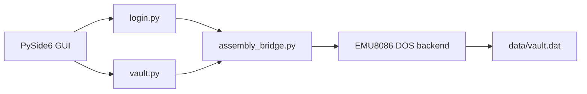

# SecureVault - 8086 Assembly Password Manager

SecureVault is a college project that combines a PySide6 interface with an
8086 Assembly backend. Python owns the application workflow and GUI; Assembly
owns master-password verification, encryption, decryption, and checksums.

## Architecture



`vault.py` keeps decrypted credentials only in the active unlocked session.
The persistent file contains an encrypted byte payload and its Assembly
checksum. CRUD operations are unavailable while the vault is locked.

## Setup

1. Install the dependency with `pip install -r requirements.txt`.
2. Ensure DOSBox is installed and `Backend/securevault.com` is the executable
   built from `Backend/securevault.asm`. Rebuild it in EMU8086 after changing
   the assembly source.
3. Run `python Frontend/main.py` from the project root.

The bridge mounts the project root as `C:`, mounts a temporary request/response
directory as `D:`, and runs `C:\Backend\securevault.com D:\request.txt
D:\response.txt`. It reads the response file rather than DOSBox stdout.
For a custom launcher, set `SECUREVAULT_RUNNER` to a command template using
`{exe}`, `{request}`, and `{response}` placeholders.

The first setup creates `data/master.dat` through the Assembly backend. The
existing empty `data/vault.json` is retained for compatibility; a non-empty
legacy list is loaded once and then saved to the encrypted vault format.

## Algorithm and limitations

The Assembly transformation XORs each byte with a changing key, adds a changing
seed, and rotates the result. Decryption reverses those operations. A rotating
16-bit additive checksum detects accidental or basic intentional modification.
These routines demonstrate 8086 arithmetic and memory handling; they are not
production-grade cryptography and must not protect real secrets.

For $n$ bytes, encryption, decryption, and checksum calculation each take
$O(n)$ time and $O(1)$ additional Assembly space. Vault serialization requires
$O(n)$ Python memory for the decrypted record list.

## Tests

Run the isolated Python tests from the project root:

```powershell
python -m unittest discover -s Frontend -p "test_*.py"
```

The tests use a fake Assembly boundary only to test vault state and CRUD logic.
The EMU8086 backend must additionally be tested with known encryption vectors,
wrong passwords, malformed requests, and modified ciphertext.
