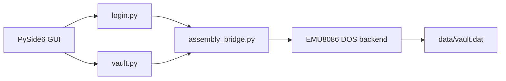

# SecureVault - 8086 Assembly Password Manager

SecureVault is a college project that combines a PySide6 interface with an
8086 Assembly backend. Python owns the application workflow and GUI; Assembly
owns master-password verification, encryption, decryption, and checksums.

## Architecture



`vault.py` keeps decrypted credentials only in the active unlocked session.
The persistent file contains an encrypted byte payload and its Assembly
checksum. CRUD operations are unavailable while the vault is locked.

## Setup

1. Install the dependency with `pip install -r requirements.txt`.
2. Open `Backend/securevault.asm` in EMU8086 and build it as a DOS `.COM`
   program. It is the executable entry point; `Encryption.asm` is a reusable
   demonstration module, while `assembly_interface.asm` documents the protocol.
3. Place the resulting executable at `Backend/securevault.com`, or set
   `SECUREVAULT_ASSEMBLY_EXE` to its path.
4. Run `python Frontend/main.py`.

If Windows cannot launch the DOS `.COM` file directly, set
`SECUREVAULT_RUNNER` to a small DOS-compatible launcher command and keep the
same two request/response path arguments. The Assembly program accepts those
paths and implements the protocol described in `Backend/assembly_interface.asm`.
Python does not fall back to Python cryptography when the executable is missing.

## Algorithm and limitations

The Assembly transformation XORs each byte with a changing key, adds a changing
seed, and rotates the result. Decryption reverses those operations. A rotating
16-bit additive checksum detects accidental or basic intentional modification.
These routines demonstrate 8086 arithmetic and memory handling; they are not
production-grade cryptography and must not protect real secrets.

For $n$ bytes, encryption, decryption, and checksum calculation each take
$O(n)$ time and $O(1)$ additional Assembly space. Vault serialization requires
$O(n)$ Python memory for the decrypted record list.

## Tests

Run the isolated Python tests from the project root:

```powershell
python -m unittest discover -s Frontend -p "test_*.py"
```

The tests use a fake Assembly boundary only to test vault state and CRUD logic.
The EMU8086 backend must additionally be tested with known encryption vectors,
wrong passwords, malformed requests, and modified ciphertext.
